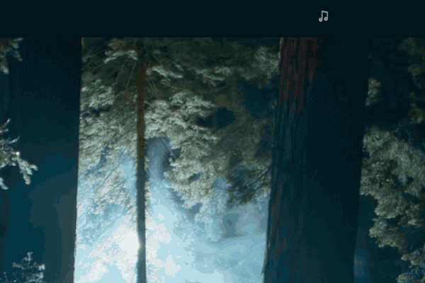

<p align="center">
  
</p>

<p align="center">
  <a href="https://github.com/shubhamcodess/notch-porch/releases/latest/download/Notch-Porch-arm64.dmg"></a>
  &nbsp;
  <a href="https://github.com/shubhamcodess/notch-porch/releases/latest/download/Notch-Porch-Setup-x64.exe"></a>
  &nbsp;
  <a href="#install"></a>
</p>

<p align="center">
  
</p>

<p align="center">
  <a href="https://github.com/shubhamcodess/notch-porch/releases/latest"></a>
  <a href="https://github.com/shubhamcodess/notch-porch/releases"></a>
  <a href="https://github.com/shubhamcodess/notch-porch/stargazers"></a>
  <a href="https://github.com/shubhamcodess/notch-porch/commits/main"></a>
  <a href="LICENSE"></a>
  
  
  
</p>

<br>

## What it is

The notch is dead space. **Notch Porch** turns it into a small, quiet dock for the things you want a glance away. On a MacBook it wraps the notch; on **Windows** it sits as a small pill at the top centre of your screen.

Hover the notch (or the pill on Windows) and a card drops down. Move away and it folds back. Every widget gets its own page in the card and its own spot beside the notch. The first one is a full YouTube Music player. More are on the way, and you can [write your own](docs/WIDGETS.md) in a single folder.

<br>

## What you get

### The dock

<table>
  <tr>
    <td width="25%" valign="top"><b>Lives in the notch</b><br>Small live items sit beside the notch. Hover to open the full card, move away to fold it back.</td>
    <td width="25%" valign="top"><b>Gets out of the way</b><br>When an app's menus or your status icons crowd the notch, the items roll behind it. Your menu bar stays yours.</td>
    <td width="25%" valign="top"><b>Quiet by design</b><br>It sleeps when idle, blocks ads, and a small leaf tells you if it ever uses too much battery or memory.</td>
    <td width="25%" valign="top"><b>Built to grow</b><br>A widget is just a folder. Drop one in and it gets its own page, its own menu and its own spot by the notch.</td>
  </tr>
</table>

### The Music widget

<table>
  <tr>
    <td width="33%" valign="top"><b>Discover</b><br>Live moods and genres straight from YouTube Music, plus quick picks. Tap a genre, tap a playlist, and the whole list plays.</td>
    <td width="33%" valign="top"><b>Search without a window</b><br>Type, play. Your recent searches wait underneath, and it closes the moment you move away.</td>
    <td width="33%" valign="top"><b>One tap to music</b><br>Press play and a pick starts, signed in or not. Shuffle works on whatever is playing, including a genre playlist.</td>
  </tr>
  <tr>
    <td valign="top"><b>Synced lyrics</b><br>One line, in time with the song, in English letters when they exist. Optionally as a soft caption just under the notch.</td>
    <td valign="top"><b>Album colors</b><br>The card takes its gradient from the cover art and drifts slowly. The equalizer picks up a matching tone.</td>
    <td valign="top"><b>A real equalizer</b><br>The bars follow the actual audio, bass to treble, and the glow pulses on the beat. No canned animation.</td>
  </tr>
</table>

### Listen together

<table>
  <tr>
    <td width="33%" valign="top"><b>Host or join a room</b><br>Flip to the Room card, tap Host, and share the ID. A friend types it in and they're in. Everyone gets a friendly name like <code>Sleepy-Panda</code>.</td>
    <td width="33%" valign="top"><b>Everyone hears the same moment</b><br>Each person plays through their own Notch Porch. Only tiny sync messages are shared, never audio.</td>
    <td width="33%" valign="top"><b>The host decides</b><br>Guests can search and request a song; the host taps ✓ or ✗. <a href="docs/ROOMS.md">How rooms work</a></td>
  </tr>
</table>

<br>

## Install

| | Download | Needs |
|:--|:--|:--|
| **Mac** | [Notch-Porch-arm64.dmg](https://github.com/shubhamcodess/notch-porch/releases/latest/download/Notch-Porch-arm64.dmg) | Apple Silicon, macOS 12 or later |
| **Windows** | [Notch-Porch-Setup-x64.exe](https://github.com/shubhamcodess/notch-porch/releases/latest/download/Notch-Porch-Setup-x64.exe) | Windows 10 or 11, 64-bit |

All versions are on the [releases page](https://github.com/shubhamcodess/notch-porch/releases).

### Mac

> [!TIP]
> Best on **MacBooks with a notch**. It also runs on Macs without one, as a small pill at the top of the screen.

**The quick way.** Paste this into **Terminal** and press Return:

```bash
curl -fsSL https://raw.githubusercontent.com/shubhamcodess/notch-porch/main/scripts/install.sh | bash
```

It downloads the latest version, puts it in **Applications**, and opens it. That's all.

**The drag-and-drop way.**

1. **Download** the DMG above.
2. **Open** it and drag **Notch Porch** onto **Applications**.
3. **Open** Notch Porch from Applications.
4. If macOS says it can't verify the app, open **System Settings → Privacy & Security**, scroll down, and click **Open Anyway**.

> [!NOTE]
> That prompt appears because Notch Porch is a free, independent app that isn't signed with a paid Apple Developer certificate. Everything is open source in this repo, and you can build it yourself. Prefer the Terminal? `xattr -cr "/Applications/Notch Porch.app"` clears it once.

### Windows

**Download the installer** from the table above and open it. It installs just for you, with no admin rights, and starts right away. Look for the small icon in the system tray; click it for the menu.

> [!TIP]
> Download it with **Chrome** or **Firefox**. They let you keep the file with one click. Edge adds an extra warning step.

Because the app isn't signed with a paid certificate yet, Windows may warn you. That's expected, and it's safe to continue:

1. **Browser:** if it says the file "isn't commonly downloaded", click **Keep** (Chrome: the `…` menu next to the file, then **Keep**).
2. **Run it:** if the blue "Windows protected your PC" screen appears, click **More info**, then **Run anyway**.

**Prefer the command line?** Open **Command Prompt** or **PowerShell** and paste:

```bat
curl.exe -L -o "%TEMP%\Notch-Porch-Setup.exe" https://github.com/shubhamcodess/notch-porch/releases/latest/download/Notch-Porch-Setup-x64.exe && "%TEMP%\Notch-Porch-Setup.exe"
```

`curl.exe` ships with Windows 10 (version 1803) and 11. A file downloaded this way has no browser warning on it. In PowerShell the same line works as long as you keep the `.exe` on the end of `curl`. More details in [Windows](docs/WINDOWS.md).

### Build it yourself

```bash
git clone https://github.com/shubhamcodess/notch-porch.git
cd notch-porch && npm install && npm start
```

Needs Node 20+ and Xcode's command line tools. More in [CONTRIBUTING.md](CONTRIBUTING.md).

### Updating, inside the app

You never need to come back here to update. Notch Porch checks for a new release about once a day. When one is out, a small dot appears next to the menu-bar (or system tray) icon, you get one notification, and **Update to vX.Y.Z** shows up at the top of its menu.

1. **Click the icon**, then **Update to vX.Y.Z**.
2. It downloads the release, checks it, replaces the app and reopens itself. About ten seconds.

This works the same on Mac and Windows. You can also check any time from **icon → Settings → Check for updates**, and turn off **Notify me of new versions** if you don't want the daily check. It never installs anything without your click.

<br>

## Your first minute

| | |
|:--|:--|
| **1. Hover the notch** | The card opens. There's no Dock icon; look for the small pill-and-bars icon in your menu bar. |
| **2. Press play** | A pick starts straight away. Or tap the magnifier to open Discover and choose a mood or genre. |
| **3. Tap the lyrics button** | The artist line becomes the current lyric, in time with the song. |
| **4. Allow Accessibility** *(optional)* | When macOS asks, say yes. It's only used to see where an app's menus end, so Notch Porch can step aside for them. |

Want your own library and recommendations? Open **menu-bar icon → Music → Open YouTube Music window** and sign in once.

<br>

## Controls

| Do this | And this happens |
|:--|:--|
| Hover the notch | The card opens |
| Move the mouse away | It folds back (also from search) |
| Magnifier, or double-click the title | Discover and search. Back arrow or **Esc** goes up one level |
| Two-finger swipe sideways, or tap the small icon under the card | Flip between cards (Music, Room). The card follows your fingers |
| Room card | Host a room, or join one with its ID |
| Lyrics button | Turns synced lyrics on and off |
| Play with nothing loaded | Starts a random quick pick |
| Shuffle | Shuffles the queue, or the genre playlist you're in |
| Menu-bar icon | Theme, lyrics under the notch, sleep timer, settings, quit |

<br>

## Questions

<details>
<summary><b>Do I need a YouTube or Google account?</b></summary>
<br>
No. It plays and discovers music without one. Signing in only adds your own library and recommendations.
</details>

<details>
<summary><b>Why does it ask for Accessibility access?</b></summary>
<br>
Only to read where the frontmost app's menu titles end, so the items can roll behind the notch instead of covering them. Nothing is recorded or sent anywhere, and everything else works if you say no.
</details>

<details>
<summary><b>Is it safe to run an unsigned app?</b></summary>
<br>
The full source is in this repository and the releases are built by GitHub Actions from it. You can read it, or build it yourself with the steps above.
</details>

<details>
<summary><b>Google won't let me sign in.</b></summary>
<br>
It sometimes blocks sign-in inside embedded browsers. See <a href="docs/TROUBLESHOOTING.md#google-refuses-the-sign-in">Troubleshooting</a> for the cookie-import fallback.
</details>

<details>
<summary><b>Do I have to re-allow Accessibility after an update?</b></summary>
<br>
Possibly. macOS ties that permission to the app's signature, and Notch Porch isn't signed with a paid developer certificate, so a new version can look like a new app. If the items stop stepping aside for menus, allow it again under <b>System Settings → Privacy & Security → Accessibility</b>.
</details>

<details>
<summary><b>How do I remove it?</b></summary>
<br>
Choose <b>Quit Notch Porch</b> from the menu-bar icon, then delete it from Applications. To remove its data too: <code>rm -rf ~/Library/Application\ Support/notch-porch</code>
</details>

<br>

## Go deeper

| | |
|:--|:--|
| [How it works](docs/HOW_IT_WORKS.md) | Architecture, folder structure and the mechanics behind the notch |
| [Design system](docs/DESIGN_SYSTEM.md) | Colors, type, motion and components, so new pieces feel native |
| [Rooms](docs/ROOMS.md) | Listening together: how it works and how to remove it |
| [Writing a widget](docs/WIDGETS.md) | Add a new page to the dock in a folder |
| [Configuration](docs/CONFIGURATION.md) | Every setting and menu option |
| [Troubleshooting](docs/TROUBLESHOOTING.md) | Fixes for the common snags |
| [Contributing](CONTRIBUTING.md) | Run it, change it, send it back |

<br>

## Credits and fine print

Notch Porch is an independent project and is **not affiliated with or endorsed by Google or YouTube**. It loads the official YouTube Music website in a hidden window and puts a notch interface on top of it. Synced lyrics come from [LRCLIB](https://lrclib.net) and are fetched live for personal use; they're subject to their owners' copyrights and are never bundled here. Blocking ads may go against YouTube's terms of service, so use it at your own discretion, and consider [YouTube Premium](https://www.youtube.com/premium) to support artists.

[MIT](LICENSE) © Shubham Prakash
